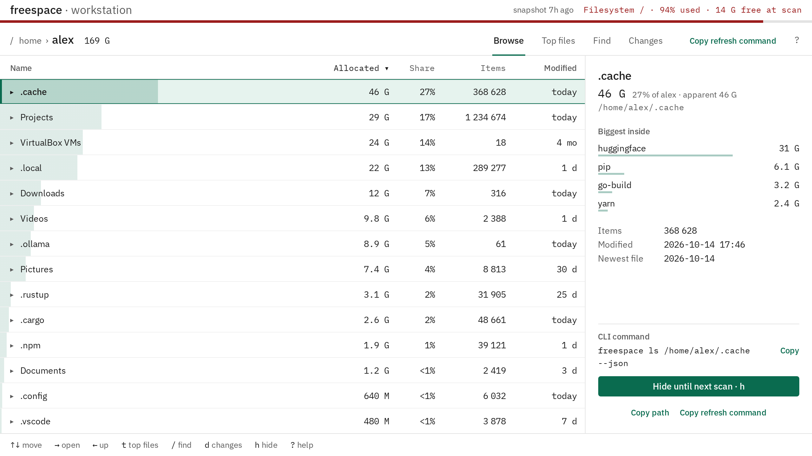
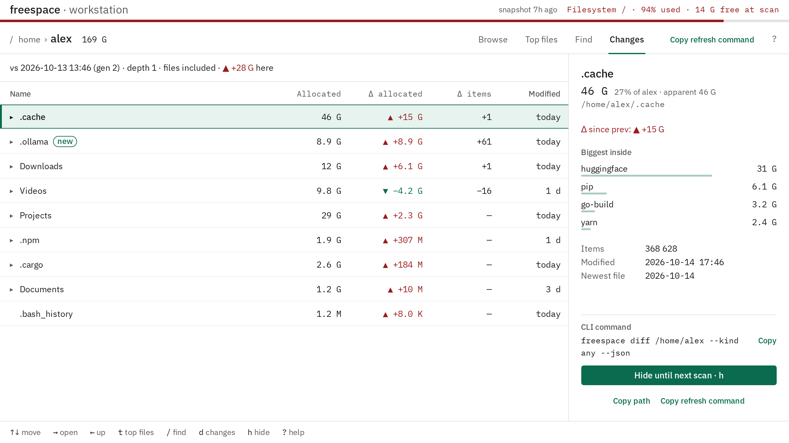

# freespace

Where did my disk go? `freespace` keeps a snapshot of the whole filesystem tree, refreshed every night by a systemd timer, so every question about disk usage is answered from that snapshot in under two seconds instead of the minutes a walk takes: in the terminal, in your browser, or for an AI agent through `--json`. It reads the disk and never changes, moves or deletes anything on it.

Linux with systemd, x86_64 and aarch64. One static binary, MIT licensed.



## How it compares

`du`, `ncdu`, `gdu` and `dust` walk the disk when you ask, and the walk is the slow part. freespace walks it at night, at idle priority, and answers from the saved snapshot. One machine, a VMware disk with 408 G in 7.8 million entries, every tool run cold as root, du and duc once, the others twice ([method and all runs](docs/benchmarks.md#current-releases)):

| Tool | Answer to "what is using my disk?" | Full walk of `/` | Peak memory of the walk |
|---|---|---|---|
| du 8.32 | after a walk | 1199 s | 9 MB |
| dust 1.2.6, 8 threads | after a walk | 484 s, 534 s | 2.78 GB |
| ncdu 2.9.1, 8 threads | after a walk | 287 s, 324 s | 11 MB |
| gdu 5.38.0, 8 cores | after a walk | 214 s, 303 s | 54 MB |
| duc 1.4.4 | from its index, after `duc index` | 1206 s | 29 MB |
| **freespace 0.1.1** | **0.01 s for a folder, under 2 s for the whole disk** | 288 s, 399 s, at night | 1.52 GB |

The walk itself is no faster than ncdu's or gdu's: all of them wait on the same disk, and the same binary took 288 s and 399 s here. It also takes more memory, because the tree is held until the snapshot is written (47 s of the 288). What that buys:

- **The answer is already there.** `freespace ls /home` and `freespace top / --min-size 1G` read last night's snapshot, as your user, without sudo and without waiting.
- **What changed since yesterday.** `freespace diff /` and the Changes view compare with the previous snapshot, so a model pulled overnight or a log that keeps growing shows up at the top, not after a hunt.
- **Questions across the whole disk, with a total.** Folders nobody touched for half a year (`freespace top / --kind dir --older-than 180d`), every ISO and how much they take together (`freespace find / --name '*.iso'`), every `node_modules`.
- **For scripts and AI agents.** Every answer comes as `--json` with a JSON Schema and stable error codes, and the installer adds a Claude Code skill.
- **In your browser, also over ssh.** `freespace gui` serves the snapshot on 127.0.0.1 ([Over ssh](#over-ssh)).



## Install

<!-- no-run -->
```sh
curl -fsSL https://raw.githubusercontent.com/mikhailsal/free-space/master/install.sh | sh
```

Before it asks for your sudo password, the installer prints what it will do:

1. download the release binary for your CPU and check its sha256;
2. install it as `/usr/local/bin/freespace` (root, 0755) with bash, zsh and fish completions;
3. run `sudo freespace install-timer`: a nightly scan at 02:00 (`freespace.timer`, idle CPU and I/O priority), read access to the snapshots for you (an ACL, so no re-login; on a filesystem without ACLs, the `freespace` group and one re-login), and the first scan right away;
4. install the Claude Code skill in `~/.claude/skills/freespace`.

It ends with a line like "freespace 0.1.0 installed in 18 s · Open: freespace gui". Options go after `sh -s --`:

<!-- no-run -->
```sh
curl -fsSL https://raw.githubusercontent.com/mikhailsal/free-space/master/install.sh | sh -s -- --no-skill
curl -fsSL https://raw.githubusercontent.com/mikhailsal/free-space/master/install.sh | sh -s -- -- --roots / /home --at 03:30
```

`--version X` installs a given release, `--no-timer` skips the nightly scan, and everything after a second `--` goes to `freespace install-timer` (see `freespace install-timer --help`). Without a terminal for the sudo prompt (an agent running it), the installer stops and prints the line for a human to run.

## The first minute

```sh
freespace
```

prints one line (free space, snapshot age) and the next commands to try. While the first scan runs, `freespace status` shows how far it got (on a 7.8-million-entry disk the first scan took four and a half minutes). Then open the browser view:

<!-- no-run -->
```sh
freespace gui
freespace gui ~/Downloads
```

Arrows move and open folders, `t` lists the biggest files, `/` finds by name, size or age, `d` shows what changed since the previous scan, `?` lists every key. The page talks to a server on 127.0.0.1 with a fresh token per run, and stops with Ctrl-C.

The same answers in the terminal, as a table, or with `--json`:

```sh
freespace ls /home --limit 10
freespace top / --min-size 1G
freespace top / --kind dir --older-than 180d
freespace find / --name '*.iso'
freespace find /home --kind dir --name node_modules
freespace diff /
```

<!-- output -->
```
/home/tass  95 G · 5 items · snapshot 7 h old
ALLOCATED  SHARE  ITEMS  MODIFIED    NAME
     83 G   88 %      4  2026-10-04  .cache/
    8.0 G    8 %      3  2026-10-04  Downloads/
    2.0 G    2 %      1  2026-10-04  old/
```

`allocated` is what deleting frees (blocks on disk), `apparent` is the file length. `find` totals every match, not just the listed page, and counts matches inside other matches once. Dates take `180d`, `4w`, `6mo`, `1y` or `2024-01-31`; sizes take `500M` or `1G`.

## Over ssh

<!-- no-run -->
```sh
ssh -t -L 8710:127.0.0.1:8710 myserver freespace gui --port 8710
```

then open the URL it prints in your local browser. Keep the `-t`: `gui` refuses to run without a terminal (so an agent never hangs on it). In a plain ssh session without `-L`, `freespace gui` prints the `ssh -N -L …` line to run on your computer instead.

## For AI agents

The installer puts a skill in `~/.claude/skills/freespace`; `freespace skill install` does it by hand, `freespace skill print` shows it. The skill teaches an agent to start with `freespace status --json`, then ask three questions in order:

1. what grew: `freespace diff / --json`;
2. what is big and untouched: `freespace top / --kind dir --older-than 180d --limit 20 --json`;
3. where exactly: `freespace ls /home --json`, descending into the biggest child.

It shows you a table of candidates with the reason each one is safe, and deletes nothing until you say yes to that list. Every `--json` answer has a JSON Schema (`freespace schema --json`, also `skill/schema.json`). CI runs every command in this README and in `skill/SKILL.md` against a test snapshot (the JSON ones are validated against the schema), so a renamed flag or field breaks the build, not your script. The sample output below is illustrative.

A `top` answer, trimmed:

<!-- output -->
```json
{
  "host": "devbox",
  "generation": 12,
  "prev_generation": 11,
  "age_seconds": 25120,
  "incomplete": false,
  "unknown_subtrees": [],
  "path": "/",
  "kind": "dir",
  "older_than": 1776890000,
  "entries": [
    {
      "path": "/home/tass/.cache/pip",
      "name": "pip",
      "kind": "dir",
      "allocated": 23622320128,
      "apparent": 23580000000,
      "mtime": 1790800000,
      "newest_mtime": 1766080000,
      "items": 1834,
      "errors": 0
    }
  ],
  "total": { "count": 1, "counted": 1, "allocated": 23622320128, "apparent": 23580000000 },
  "truncated": false
}
```

On failure, `--json` still prints JSON on stdout: `{"error": {"code", "exit", "message", "fix", "recovery": {"action", "side_effects", "max_retries"}, "docs"}}`. Key on `error.code`; `recovery.action` is one of `retry`, `wait`, `fix_input`, `use_json`, `ask_human`.

## Something wrong?

```sh
freespace doctor
```

checks the config, the timer and its unit, the installed binary and `PATH`, read access to the snapshot, its age, the last scan error, free space for the next scan and the skill, and prints the command that fixes each failing check (`freespace doctor --json` for scripts).

Every error names a code. The `docs` link in an error points here:

| Code | Exit | What happened | What to do |
|---|---|---|---|
| <a id="error-generic"></a>`GENERIC` | 1 | Unexpected failure: I/O, SQLite, a publish step. | Run `freespace doctor`. If it keeps happening, [open an issue](https://github.com/mikhailsal/free-space/issues/new?template=bug.md). |
| <a id="error-space"></a>`SPACE` | 1 | Not enough free space for a new snapshot. The old snapshot is kept. | Free space on the snapshot's filesystem (`freespace doctor` says how much the next scan needs), move `snapshot_dir`, or set `keep_previous = false`. |
| <a id="error-usage"></a>`USAGE` | 2 | Bad command line or query parameter. | Every command takes `--help`. Against a remote host, compare `error.context.version` with yours. |
| <a id="error-config"></a>`CONFIG` | 2 | `/etc/freespace/config.toml` is unreadable or invalid. | The message names the key; fix or remove it. |
| <a id="error-gui-no-tty"></a>`GUI_NO_TTY` | 2 | `gui` started without a terminal. | Run it in your own terminal (over ssh with `ssh -t`). Agents use the `--json` commands. |
| <a id="error-path-not-found"></a>`PATH_NOT_FOUND` | 2 | The path is not in the snapshot: outside the scanned roots, or newer than the last scan. | `fix` names the nearest folder that is there. `sudo freespace refresh <path>` rescans a folder now. |
| <a id="error-no-prev"></a>`NO_PREV` | 3 | `diff` has no previous snapshot to compare with (first day, or `keep_previous = false`). | Wait for the next scheduled scan; use `top` and `ls` meanwhile. |
| <a id="error-rotated"></a>`ROTATED` | 4 | A new snapshot was published in the middle of the query. | Run the same command again. |
| <a id="error-schema"></a>`SCHEMA` | 5 | The snapshot was written by a freespace with another format. | Rescan: `sudo systemctl start freespace.service` or `sudo freespace scan`. |
| <a id="error-lock"></a>`LOCK` | 6 | A scan or refresh is already running. | Wait; `freespace status` shows its progress. |
| <a id="error-hash-collision"></a>`HASH_COLLISION` | 7 | A `diff` pair failed raw path verification. | [Report it](https://github.com/mikhailsal/free-space/issues); `ls` and `top` are not affected. |
| <a id="error-no-snapshot"></a>`NO_SNAPSHOT` | 8 | Nothing scanned yet. | Install with the one-liner above, or `sudo freespace scan`. If `freespace status` shows a scan running, wait for it. |
| <a id="error-snapshot-access"></a>`SNAPSHOT_ACCESS` | 9 | The snapshot exists but this user cannot read it. | `sudo freespace install-timer` gives the sudo user read access (`--user NAME` for someone else). |
| <a id="error-not-root"></a>`NOT_ROOT` | 1 | `scan`, `refresh` and `install-timer` need root. | Run it with `sudo`. |
| <a id="error-not-supported"></a>`NOT_SUPPORTED` | 1 | Not available here, e.g. no systemd for the timer. | Run `sudo freespace scan` from cron or by hand. |

## Upgrade, roll back, uninstall

Upgrade by running the install line again. The snapshot is kept; if the new version changed its format, a rescan starts and `diff` answers `NO_PREV` until the scan after that.

Roll back to any release, back to the first public one:

<!-- no-run -->
```sh
curl -fsSL https://raw.githubusercontent.com/mikhailsal/free-space/master/install.sh | sh -s -- --version 0.1.0
```

Uninstall removes the timer and unit, `/etc/freespace`, the snapshots, the completions, the skill and the binary (the `freespace` group stays):

<!-- no-run -->
```sh
sudo freespace install-timer --uninstall
```

## Configuration

`/etc/freespace/config.toml`, written by `install-timer`. Every key is optional; `roots` is filled in with the real filesystems mounted at install time, and an empty list means "every real filesystem at scan time":

<!-- output -->
```toml
roots = ["/", "/home"]
snapshot_dir = "/var/lib/freespace"
keep_previous = true            # previous snapshot for diff; needs room for both
# workers = 4                   # walker threads; default min(CPUs, 8)
port = 0                        # gui/serve port; 0 picks a free one
interval = "daily"              # hourly, daily or weekly
at = "02:00"
```

Change it with `sudo freespace install-timer --roots / /home --interval daily --at 03:30` rather than by hand: that also rewrites the timer.

## <a id="from-source"></a>Build from source

Needs Rust 1.88 or newer and [bun](https://bun.sh) 1.4 or newer (the build bundles the web page into the binary).

<!-- no-run -->
```sh
git clone https://github.com/mikhailsal/free-space
cd free-space
cargo build --release
sudo install -m 0755 target/release/freespace /usr/local/bin/freespace
sudo freespace install-timer
```

How it works, in short: one parallel walk of the tree, written into a new SQLite file that replaces the old one with a rename, so readers never see a half-written snapshot. About 135 bytes per entry on disk (1 GB for 7.7 million files). Timings against `du`, `ncdu`, `gdu`, `dust` and `duc`: [docs/benchmarks.md](docs/benchmarks.md). Design notes: [docs/designs/free-space-disk-analyzer.md](docs/designs/free-space-disk-analyzer.md). Contributing: [CONTRIBUTING.md](CONTRIBUTING.md).

## License

[MIT](LICENSE).
