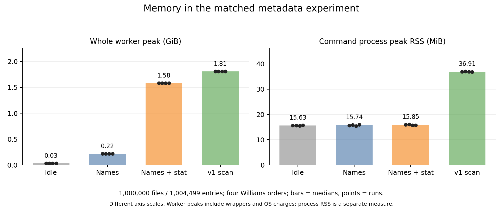

# Why RAM and disk grow, and what to change

Date: 2026-11-02. Status: causal investigation complete for the stated cases;
optimization and product qualification remain separate work. MiB=2^20 bytes;
GiB=2^30 bytes. Process RSS, worker-cgroup RAM, persistent allocation and peak
filesystem allocation are different measures.

## Findings already supported by prior evidence

| Cost | Cause and evidence | Practical implication |
| --- | --- | --- |
| Full-scan total RAM greatly exceeds process RSS | The staged v1 walker avoids a complete heap tree, but visits every entry and reads metadata. The new matched 1m experiment shows that explicit metadata lookups alone add a median 1.3641GiB worker peak and 1.2504GiB endpoint reclaimable slab over names-only traversal. | Metadata lookup is sufficient to cause a large kernel/cache charge in this environment. Reducing a SQLite cache or Rust buffer alone has limited reach over that charge. |
| A tiny v1 folder refresh uses a large heap | The refresh path loads, grafts, renumbers/folds and rewrites the entire snapshot. Adding99 descendants in the7,297,076-entry test doubled node capacity from7,297,076 to14,594,152. A pre-sizing strategy kept capacity7,297,175 and reduced one full-scale process peak by561.797MiB; total-cgroup peak fell178.781MiB. | Exact capacity is a supported allocation-strategy improvement, but the whole-tree algorithm remains the larger structural cost. The older source/build, one full pair, positive time difference and diagnostic limits prevent promotion. |
| V1 peak disk exceeds its retained snapshots | Current, previous, full replacement and staging representations overlap while output is built. Publication hardlinks current for rotation, rather than copying another fourth snapshot. Ordinary endpoints retain two generations. | Disk work must target concurrent representations or their sizes; moving stage drop merely before publish saves nothing because it already occurs there. Reader-held deleted inodes and SQLite temporary files require explicit accounting. |
| V2 keeps growing on unchanged complete scans | In the original7,202,464-entry sequence, each full scan writes another complete version set. Five scans produced36,012,320 versions while live and identity counts stayedN; retained allocation rose3.036->5.877GiB. Page categories show version rows and history indexes growing. Tiny18-entry refreshes added19 versions each instead. | Fix the full-scan write set and retention, rather than assuming all refreshes rewriteN versions. Changing an engine while writing the same versions preserves the growth mechanism. |

The [prior-evidence report](resource-causes-prior-evidence-2026-11-02.md) supplies
actual binary/source identities, raw archive members, indexed payload checks,
measured byte values and limits for each row. Older GNU, older musl and current
canonical ED2 results are not pooled as one build.

## Why a large charged peak is not the minimum required RAM

Linux cgroups charge anonymous memory, cached file data and kernel structures.
`slab_reclaimable` is part of kernel memory, so adding both as independent
categories double-counts. Mapped virtual address space also is not a resident
RAM requirement. [Linux memory accounting](https://www.kernel.org/doc/html/latest/admin-guide/cgroup-v2.html).

A full-scale4GiB baseline reached its limit with many max events, so it cannot
show an unconstrained maximum. Two separate exact-ED2 full scans at1GiB completed
without swap/OOM in1116.836 and1303.922 seconds. Thus1GiB is a tested successful
worker setting for that fixture, while the exact minimum remains unmeasured.
Those times do not isolate a memory-limit slowdown; no unmatched cross-run
comparison is used to claim a source gain. Setup and semantic observers had
separate budgets and their independently occurring peaks are not added.

## New controlled RAM and disk proof

The source is `51ff2065e49184583932c2ef6d90152c1a586671`, protocol
`resource-cause-v1`, baseline E826/ED2. The100k smoke
[41372382738](https://github.com/mikhailsal/free-space/actions/runs/41372382738)
passed all six cases, independent source/count/semantic/cleanup replay and used
110runner-seconds. Its archive SHA-256 is
`d515eeaf5ef09fee42ddc5233b7bfa7fd24d868622781aca5c2720e7b8ec2bc6`.
GitHub upload excluded a hidden workflow source copy; a separate analysis copy
restored that exact byte from the frozen Git revision with matching runtime and
source-freeze SHA-256. Raw artifacts are preserved. No measurement was rerun.

The 23-case 1m screen
[41373680085](https://github.com/mikhailsal/free-space/actions/runs/41373680085)
completed successfully in **1,257 job-seconds**. Its prospectively frozen
whole-step forecast including 30% margin was 1,765.096s, below 2,700s, with
independent host/cleanup admission checks. Host elapsed was 1,183.337s, below
its 2,100s cap. All 23 strict receipts and 11 scan semantic observers passed;
independent same-source recomputation exactly matches the stored summary.
The actual E826 application remains unchanged, with binary SHA-256
`ed2a1cb138b1e48e70a388a4a8fda3e79fcfd2e37fd0c061d41d2d6363f8e980`.
All 23 retained harness source hashes and actual binary bytes match the freeze.
The isolated harness passed 68 new tiny/mocked tests and 121 existing tests.

The [screen receipt](resource-cause-screen-2026-11-02.json) and
[raw archive](resource-cause-screen-2026-11-02.tar.gz) preserve the original
binary, raw measurements, run records, transport recovery and independent
RAM/disk checks with an internal SHA-256 index. The same hidden-workflow upload
omission was recovered in a separate analysis copy from the immutable revision,
matching both runtime and frozen hashes. Original payloads are preserved;
no measurement, source or gate was changed or rerun.
The [prospective plan](../designs/resource-cause-proof-plan-2026-11-02.md)
defines raw-byte/count invariants, Williams order, fixed outcome thresholds,
collector pairs, inode retention/release, bounded open-deleted-file observations,
provenance, semantics, deadlines and financial admission. A100k smoke only
validates that protocol; a separately admitted1m screen supplies mechanism data.

### Full-scan RAM: metadata is a demonstrated cause

The fixture contains 1,000,000 regular files and 4,499 directories: 1,004,499
entries. Workers have two CPUs, 4GiB RAM, no swap, one scan worker and forced
low-memory staged v1. The direct loop-backed ext4 I/O envelope is 32MiB/s read
and write, 2,200 read IOPS and 3,600 write IOPS. These are controlled synthetic
conditions; equivalence to the user's physical local disk remains unproved.

Four Williams-order rounds compare idle, streaming names, the same traversal
plus explicit metadata calls, and the unchanged v1 scan. Names/stat probes
produce identical raw path-and-kind digests. Each stat probe adds 1,004,498
non-root metadata calls; a root lookup and directory opens are common work.
The metadata-only probe writes no application database.

| Command | Median worker peak, GiB | Median process peak RSS, MiB | Median seconds |
| --- | ---: | ---: | ---: |
| Idle | 0.0331 | 15.627 | 1.066 |
| Names | 0.2175 | 15.740 | 20.596 |
| Names + stat | 1.5816 | 15.854 | 34.215 |
| v1 scan | 1.8074 | 36.906 | 54.324 |

Worker peaks are frozen kernel `memory.peak` values through post-command
capture, including wrappers, sampler and OS charges. GNU-time command RSS is
a separate process measure; probes and Rust CLI are different commands.

Across the four stat-minus-names comparisons, extra endpoint reclaimable slab
is 1,342,583,096–1,342,598,504B, median **1.2504GiB**. Extra worker peak is
1,464,340,480–1,465,077,760B, median **1.3641GiB**. Every difference exceeds
the fixed 64MiB floors and the idle/names cross-round ranges of 14,296B slab
and 647,168B peak. The registered `primary_metadata_effect` is **supported**.

Metadata-only cases reproduce 99.720–99.721% of the scan's endpoint reclaimable
slab and 87.488–87.537% of its worker peak. All exceed the registered 0.75
comparability threshold, and collector controls pass, so
`metadata_scan_comparability` is **supported**. These ratios compare distinct
interventions and observation times. They are not an additive peak
decomposition or a claim that exactly 87.5% of ordinary scan RAM can be removed.
They show that explicit metadata lookup is sufficient to cause a large charge
of comparable scale in this environment.

Median endpoint readings after the command exits provide category context:

| Command | Anonymous, MiB | File, MiB | Kernel, MiB | Reclaimable slab, MiB |
| --- | ---: | ---: | ---: | ---: |
| Names | 8.732 | 194.613 | 12.328 | 11.935 |
| Names + stat | 8.719 | 311.008 | 1,292.730 | 1,292.329 |
| v1 scan | 8.730 | 439.355 | 1,296.348 | 1,295.961 |

These sequential endpoint observations are not true-peak components. The Rust
CLI has already exited; remaining anonymous memory includes the wrapper, not
its live heap. Slab is part of kernel memory and must not be added again.
Host-wide dentry/ext4-inode observations support the metadata-cache mechanism
but do not identify objects charged to this cgroup.

Three full-versus-reserve collector pairs pass every prospectively fixed
exploratory band. Largest absolute differences are 348,160B (0.332MiB) worker
peak, 152KiB process RSS and 0.201343s. Both modes retain common safety polling.
This describes incremental overhead at this scale/cap, not zero overhead or a
population confidence interval. No case has swap, OOM/kill, cap or reclaim
evidence. The independent RAM audit recomputed 146 checks, all passing.

### Disk: complete held budget and controlled release

The quiescent pass deliberately retains old stage/previous inodes after
publication to inspect their allocation and last-FD release. It extends
lifetimes and is not an ordinary scan latency/RAM or true-peak measurement.

| Held object | Logical SQLite bytes | Inode allocated bytes |
| --- | ---: | ---: |
| Published current, formerly replacement | 128,012,288 | 128,012,288 |
| Published previous, formerly current | 128,012,288 | 128,016,384 |
| Pinned old previous | 128,012,288 | 128,012,288 |
| Pinned stage | 75,714,560 | 75,718,656 |
| State + lock | 163 | 4,096 |
| **Distinct-inode total** | **459,751,587** | **459,763,712 / 438.465MiB** |

Read-only, closed `dbstat` inspections bind each database to its held
device/inode and stable before/after identity. Stage has 42,389,504B table
pages, 33,320,960B index pages and one 4,096B schema page. Each snapshot has
69,500,928B table pages, 58,507,264B index pages and one schema page. Freelist
count is zero. Page sums exactly equal logical images; two inode allocations
exceed their images by 4,096B each. Their exact filesystem mechanism is
unidentified, not an extra SQLite page or last-page rounding.
[SQLite dbstat coverage](https://www.sqlite.org/dbstat.html).

After private aliases are removed, both pinned inodes have zero links. Closing
stage's last FD frees **75,718,656B**; closing old previous's frees
**128,012,288B**. All 11 immediate/settling observations for each release show
residual zero at 4,096B filesystem quantization. Total controlled reclamation
is **203,730,944B / 194.293MiB**, leaving **256,032,768B / 244.172MiB**, exactly
matching final named allocation. Source transitions and live inode identities
support the overlap mechanism; these counterfactual releases prove which
allocation each retained file holds.

All four ordinary Latin scans and the retained pass share the frozen-formula
app filesystem metric **459,771,904B**. This is sampled filesystem growth plus
recorded initial snapshot allocation, not a held-file sum or exact instantaneous
peak. The held sum differs by 8,192B. Actual endpoint initial allocation is
4,096B above the frozen spec's initial value; substituting it gives a separately
derived 459,776,000B, rather than silently revising the registered result.
The diagnostic named maximum is also 459,776,000B; bracketed observations are
not atomic. Small filesystem/timing/normalization residuals remain explicit.

The watcher records 1,073 polls, 672 complete inventories and 432 source-labelled
races; 176 detailed error records overflow its bounded log. There are no
fatal/limit failures, but `coverage_complete=false`: absence of unseen SQLite
temporaries or a true peak bound cannot be established. Independent component
maxima must not be added. Per-object pages, inode chains, release samples and
residuals are retained in the independent disk audit inside the raw archive.

## Disk savings must follow the simultaneous budget

Write a same-time v1 budget as current+previous+new+stage+actual temporaries and
filesystem residual. Database indexes are already included in their owning
files. Holding other allocations fixed, complete stage is 16.47% of the new
held model and one snapshot is 27.84%. These are conditional representation
ceilings, not promised savings or bounds on an unsampled true peak.

Existing full-scale samples give a3.126GiB app metric, a529.988MiB stage maximum
and890.320MiB logical size per snapshot. Conditional representation ceilings,
holding other allocations fixed, are about16.56% for removing the complete
stage and27.8% for removing one previous generation. These are not promises of
achievable savings or bounds on an unsampled peak. Existing `keep_previous=false`
removes previous after publication; it does not avoid old previous during the
write if the same two-generation seed is retained. Physical history policy must
be explicit even though the owner says historical snapshots have little value.

V2 GC could remove three of five obsolete version sets in the clean sequence
while keeping current/previous, a60% version-row count reduction. It does not
imply60% fewer bytes: identities/live rows/protected history remain, DELETE can
leave reusable pages allocated, readers can defer reclamation and checkpointing
has its own cost. Physical shrink and its peak/time remain unmeasured.

## Improvement priorities and storage alternatives

The existing v2 sparse refresh is a useful positive algorithm control: in the
older native GNU sequence, three unchanged18-entry refreshes used8.02-8.14MiB
RSS and0.0169-0.0302s versusabout1.081GiB and26.497-28.929s for v1. These consecutive,
not cache-controlled commands on7,202,464entries have no fresh per-command
cgroup peak, are not the new
canonical musl screen, and do not establish general speed or total-RAM gains.
They nevertheless support preserving/reusing the sparse algorithm while
investigating v2's full-scan history cost. Discarding that algorithm solely
because complete scans grow history would miss an already implemented benefit.

1. **Make small refreshes perform small logical work.** Stable entry identities,
   ordering indirection and exact ancestor/hardlink indexes address whole-tree
   load/renumber/fold/rewrite. First express that algorithm in SQLite; an engine
   comparison must use the same write set and semantics. Exact-capacity loading
   is a smaller supported first step, not removal of O(N) work.
2. **Reduce actual concurrent disk representations.** Inspect measured stage and
   final page categories; change one redundant structure or lifetime at a time.
   A no-previous-history policy is a distinct product tradeoff, not a free
   implementation win. Reader/crash/disk-full behavior must be preserved or
   deliberately redefined before comparison.
3. **Stop unnecessary full-scan version creation in v2.** Explore content-version
   reuse with separately represented observation freshness, then bounded GC and
   complete WAL/checkpoint maintenance. Charge all deferred work and reader pins.
4. **Test total-RAM policy against the responsible category.** The metadata
   intervention supports a large kernel/cache cause. Test a matched pressure/
   capacity policy and throughput rather than declaring a small SQLite-cache
   reduction a total-RAM solution. File-cache hints after durable use and
   application allocation changes need their own controlled questions; no global
   production cache drop is proposed.
5. **Prototype one storage challenger only after the algorithm is defined.**
   LMDB/heed may reduce private decoding/cache copies and permit sparse B-tree
   updates, but mapped file pages and reader-pinned COW data remain costs.
   RocksDB adds memtable/cache/compaction/checkpoint budgets to justify. A packed
   immutable base plus delta may reduce representation and write traffic, with
   the largest query/publication/compaction correctness burden. None is measured
   faster or smaller here.

The [storage hypotheses](../designs/resource-stack-hypotheses-2026-11-02.md)
include primary documentation, four-metric tradeoffs, falsifiers and a fair
GitHub prototype design for SQLite, LMDB, RocksDB and packed base/delta. A language
rewrite alone does not remove required metadata visits, dense-ID rewrites or
retained generations. New-format prototypes are research proposals, not shipped
changes or benchmark-qualified replacements.

The next experiment should preregister a single mechanism, all four metrics,
maintenance/reader costs, correctness invariants and stopping rules. Sparse
refresh is falsified if exact hardlink/ancestor maintenance restores near-N
work or correctness fails. Full-scan content reuse is falsified if unchanged
scans still add N content versions or retention/physical maintenance remains
unbounded. Disk-layout changes fail if required sort/rebuild work consumes the
saving or breaches the accepted time tradeoff. Pressure-policy experiments must
measure throughput at the same source; a charged-peak decrease alone is not a
source improvement. The owner's allowance of up to 15% slowdown requires a
worthwhile resource exchange, not a post-data waiver of inconclusive gates.

## Completion and acceptance

The diagnostic campaign used **1,367 runner-seconds / 22m47s**. Aggregate
completed use is **52,011 seconds / 14h26m51s** of the authorized **60 hours**.
No job is running; older plans conditionally reserve 34,800 seconds. Maximum
committed is 86,811 seconds, leaving 129,189 unreserved. The
[campaign ledger](v1-w1-campaign-2026-10-31.json) distinguishes actual use from
unused reservations.

The canonical1af source remains held by inconclusive H2, despite its1m scan-time
and RSS improvements; a substantial total-RAM saving is not proved. The new
54.324s scan is not an optimization gain against another run: the binary is
unchanged and the protocol differs. No master merge, PR, installed-backend
change or product qualification follows from this investigation.

The separate local disk-full incident was traced to scheduled acceptance
checks copying the corporation tree into temporary directories, including
generated review evidence. Both automatic and AI check timers are disabled and
inactive; their services are stopped, as authorized. No user files were deleted.
This is separate from the controlled application storage mechanism above.
